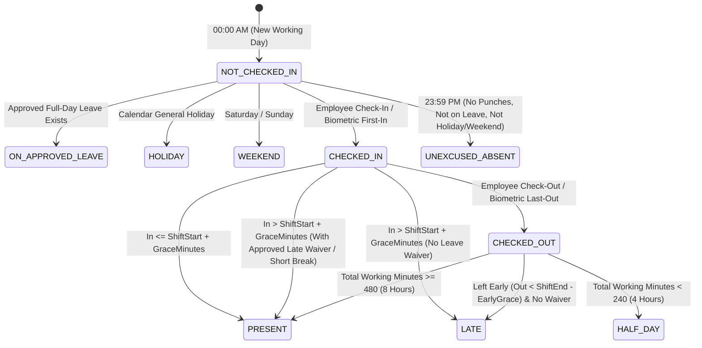

# Enterprise Attendance & Biometric Engine — System Behavior Specification

**Module**: `com.example.hr_management_backend.features.attendance`  
**Architectural Tier**: Core Operational Ingestion & Time-Tracking Domain  
**Inter-Feature Dependencies**:
- Upstream: [Employee](#node-employee) (Shift configurations, grace allowances, biometric alias)
- Ingestion: Biometric Excel Attendance Importer (Pure JVM Streaming Reader)
- Integration: [LeaveRequest](#node-leaverequest) (Leave immunity, half-day/permission adjustments)
- Downstream: [PayrollProcessingService](#node-payrollprocessingservice) (LOP day deductions, overtime hours calculation)

---

## 1. Core Domain Principles & Architectural State Machine

Attendance represents an immutable daily record of an employee's presence, punch timings, working minutes, and compliance with statutory and organizational shift policies.

---

## 2. The 12 Enterprise Attendance Rules

### Rule 1: Idempotency & Unique Punch Record Constraint
* Every employee possesses at most **one** attendance record per calendar date.
* Enforced at database engine level via `@Table(uniqueConstraints = @UniqueConstraint(name = "uk_attendance_emp_date", columnNames = {"employee_id", "date"}))`.
* Any duplicate punch or re-import for the same employee on the same date performs an in-place update (upsert) rather than creating phantom rows.

### Rule 2: Non-Destructive Check-In & Progressive Check-Out
* **First Check-In**: Records the employee's initial punch time (`checkInTime`).
* **Subsequent Morning Punches**: A subsequent check-in call preserves the **original** `checkInTime` (never overwriting it).
* **Check-Out**: Sets or updates `checkOutTime`. Working duration is dynamically calculated:
  $$\text{totalWorkingMinutes} = \text{Duration}(\text{checkInTime}, \text{checkOutTime}).\text{toMinutes()}$$
* If an employee checks out multiple times during the day, the latest check-out is retained as `lastOut`, extending working duration accordingly.

### Rule 3: Configurable Universal Shift Windows & Grace Thresholds
* Shift parameters are loaded dynamically from `SettingsService` with enterprise fallbacks:
  - Universal Shift Start: `shiftStartTime` (Default: `10:00:00`)
  - Universal Shift End: `shiftEndTime` (Default: `19:00:00`)
  - Late Arrival Grace Period: `lateArrivalGraceMinutes` (Default: `15 minutes` -> `10:15:00`)
  - Early Out Grace Period: `earlyOutGraceMinutes` (Default: `0 minutes` -> `19:00:00`)
* **Employee-Specific Shift Overrides**:
  - If `Employee.lateArrivalAllowedUntil` is defined (e.g. `10:30:00`), it takes precedence over the universal cutoff for that specific employee.
  - If `Employee.earlyOutAllowedAfter` is defined (e.g. `18:30:00`), it overrides the universal early out cutoff.

### Rule 4: Late Arrival & Early Out Penalty Classification
* An attendance punch is classified as `LATE` if:
  - `checkInTime.isAfter(effectiveLateCutoff)` AND no approved waiver exists.
  - OR `checkOutTime.isBefore(effectiveEarlyCutoff)` AND no approved early waiver exists.
* An approved `LATE_ARRIVAL` permission waives the late penalty up to the approved waiver end-time.
* An approved `EARLY_OUT` permission waives the early departure penalty after the approved waiver start-time.

### Rule 5: Working Hours Duration Thresholds (Full-Day vs. Half-Day)
* Full working day requirement: 480 minutes (8.0 hours).
* Half-day minimum threshold: 240 minutes (4.0 hours).
* Classification rules on completed working duration:
  - If $\text{totalWorkingMinutes} \ge 240$ and $< 480$: Classified as `HALF_DAY`.
  - If $\text{totalWorkingMinutes} < 120$ (2 hours): Classified as `UNEXCUSED_ABSENT` (insufficient duration).

### Rule 6: Leave Immunity & Retroactive Evaluation
* **Full-Day Leave Immunity**:
  If an employee has an approved full-day leave (`CASUAL`, `SICK`, `EARNED`, `WFH`) for date $D$:
  - Manual check-in cannot overwrite the record into an unexcused state.
  - Biometric punches logged on an approved leave day retain `PAID_LEAVE` or `PRESENT (WFH)` status.
* **Retroactive Leave Event Sync**:
  When `LeaveApprovedEvent` is fired by the Leave Engine:
  - For full-day leaves: `syncLeaveToAttendance` sets status to `PAID_LEAVE` or `LOP_LEAVE`.
  - For time-based permissions (`SHORT_BREAK`, `EARLY_OUT`, `LATE_ARRIVAL`): `reEvaluateAttendance` is invoked to recalculate whether historical punches should be upgraded from `LATE` to `PRESENT`.

### Rule 7: Pure JVM In-Memory Biometric Parsing (Zero OS Dependencies)
* To guarantee 100% cloud portability (Docker, Kubernetes, AWS/GCP, Linux):
  - Biometric Excel files (`.xlsx`, `.xls`) are parsed completely in-memory using Apache POI.
  - Zero reliance on external Python executables or hardcoded local paths (`ProcessBuilder`).
  - Native resilience: Handles both raw biometric exports (multi-column time punches: `In 1`, `Out 1`, `In 2`, `Out 2`) and pre-beautified sheets automatically.

### Rule 8: Multi-Token Name & Biometric Alias Matching
* Ingestion resolves raw biometric employee names to internal database employees via 4 fallback cascades:
  1. Exact match on `Employee.biometricName` (configured alias).
  2. Full name match: `(firstName + " " + lastName).toLowerCase()`.
  3. Single-word token match: `Employee.firstName.toLowerCase()`.
  4. First whitespace token match: `rawName.split(" ")[0]`.
* If no employee matches, the punch row is recorded in `BiometricImportSummaryDto.unmatchedRows` as `UNMATCHED` without terminating the batch.

### Rule 9: Idempotent Batch Deduplication
* If an Excel biometric export contains multiple rows for the same employee:
  - Rows are aggregated into a single `Attendance` record per employee for the target date.
  - `firstIn` takes the earliest chronological punch; `lastOut` takes the latest chronological punch.
  - Batch commit uses `attendanceRepository.saveAll()` with zero duplicate key exceptions.

### Rule 10: Strict RBAC & Self-Service Authorization
* `POST /api/v1/attendance/check-in` & `/check-out`:
  - Derives `employeeId` from the authenticated JWT security context (`authentication.getName()`).
  - Employees cannot spoof check-in or check-out for other employees (IDOR immunity).
* `POST /api/v1/attendance/import-biometric` & `DELETE /clear-all`:
  - Strictly restricted to `ROLE_SUPER_ADMIN`, `ROLE_ADMIN`, and `ROLE_HR`.
* `GET /api/v1/attendance/employee/{id}` & `/calendar-summary`:
  - Restricted to self-ownership (`@attendanceSecurity.isSelf`), direct managers, or HR/Admin.

### Rule 11: Weekend & Holiday Policy Alignment
* Standard weekend days: `SATURDAY` and `SUNDAY`.
* General Holidays: Loaded dynamically from `HolidayRepository`.
* Both Attendance calendar calculation and Payroll monthly sync treat Saturdays, Sundays, and General Holidays uniformly as non-working days, preventing false LOP deductions.

### Rule 12: Payroll Contract Harmonization
* Status vocabulary passed from Attendance to Payroll:
  - `PRESENT` / `PRESENT (WFH)` -> 0 LOP.
  - `PAID_LEAVE` -> 0 LOP.
  - `HALF_DAY` / `HALF_DAY_LEAVE` -> 0.5 LOP.
  - `LOP_LEAVE` / `UNEXCUSED_ABSENT` / `ABSENT` -> 1.0 LOP.
* When attendance tracking is disabled for an employee (`isAttendanceTracked = false`), LOP deduction is always 0.0.
